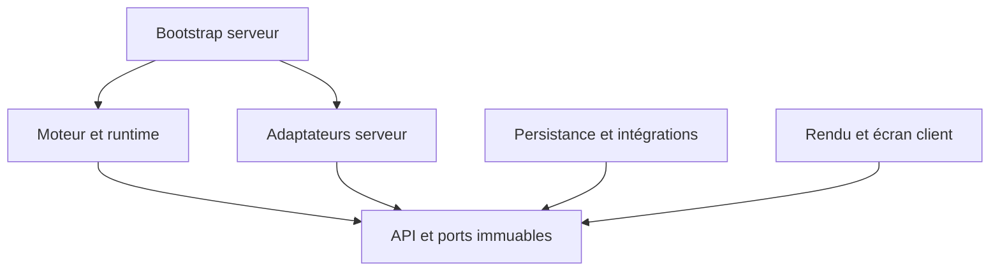
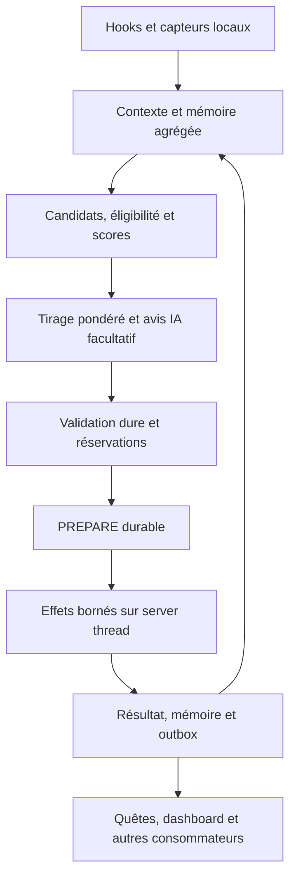

# WORLD_DIRECTOR_ARCHITECTURE

Contrat 1.0.0 · tout accès monde se fait au travers des adaptateurs.

## 1. Découpage et sens des dépendances

Racine Java : `fr.proutlost.director`. Le nom de domaine sert de convention interne et n'affirme pas la possession d'un domaine web. Un seul JAR NeoForge peut embarquer les modules ; le découpage logique est obligatoire même si le dépôt n'est pas multi-module Gradle.

| Package/module | Responsabilité et classes principales | Dépendances autorisées |
| --- | --- | --- |
| `api.model`, `api.port`, `api.error` | IDs, DTO, interfaces et résultats, sans Minecraft | JDK |
| `catalog` | `DefinitionLoader`, `DefinitionValidator`, `PrimitiveRegistry`, `CatalogSnapshot` | api |
| `memory` | `RegionService`, `MemoryReducer`, `PatternDetector`, `FairnessTracker` | api |
| `engine` | `WorldDirector`, `CandidateGenerator`, `EligibilityEngine`, `ScoreEngine`, `WeightedSelector`, `PacingController` | api |
| `runtime` | `EventRunner`, `ChainRunner`, `DisasterRunner`, `ResourceArbiter`, `MutationCoordinator`, `OwnershipService` | api |
| `persistence` | `JournalWriter`, `CheckpointStore`, `RecoveryCoordinator`, `InboxOutboxStore` | api |
| `adapter.neoforge.server` | hooks, snapshots, mutations, attachments, météo, navigation, bootstrap serveur | api + API Minecraft/NeoForge |
| `adapter.neoforge.network` | registration payload, codecs, session/epoch | api + API réseau |
| `client.perception` | audio, silhouettes, ghost rendering sans collision, TTL | api + classes client |
| `admin.server`, `admin.client` | façade/commandes puis écran de contrôle | api ; classes client seulement dans admin.client |
| `integration.quest`, `integration.locations`, `integration.ai` | adaptateurs facultatifs et import DTO | api |
| `bootstrap` | composition, lifecycle, config, versions | modules serveur ; liaison client conditionnelle |
| `testkit` | fakes déterministes, fault injection, fixtures | api, jamais embarqué dans le chemin gameplay |

Les modules d'algorithmes dépendent de ports, jamais des implémentations des voisins. `bootstrap` injecte ces ports. Un port peut être implémenté par un module sans créer de dépendance inverse. `admin.client` et `client.perception` ne sont pas référencés par une signature serveur. Les vérifications de dépendances doivent interdire les imports transverses non listés.



## 2. Ports à geler avant développement parallèle

Les signatures ci-dessous sont des contrats, pas du code implémenté. Tous les objets nommés sont définis dans le modèle de données ; les listes/maps sont immuables, triées lorsque leur ordre participe à un résultat.

```java
interface ObservationPort { SnapshotBatch sample(SampleRequest request); }
interface MemoryPort {
  MemoryView view(ScopeSet scopes);
  Reduction reduce(MemoryView before, ObservationBatch input, DirectorClock clock);
}
interface CatalogPort { CatalogSnapshot current(); }
interface DecisionPort { DecisionProposal evaluate(DecisionInput input); }
interface AdmissionPort { AdmissionResult admit(AdmissionRequest request); }
interface WorldEffectPort {
  EffectPreparation prepare(EffectIntent intent);
  SliceResult apply(PreparedSlice slice, CommitPermit permit);
  ReconcileResult reconcile(RecoveryProbe probe);
  CleanupResult cleanup(CleanupIntent intent, CommitPermit permit);
}
interface DurableStore {
  CompletionStage<CommitAck> append(DurableBatch batch);
  StoreView view(StoreQuery query);
}
interface FactBusPort {
  Subscription subscribe(ConsumerSpec consumer);
  CompletionStage<ConsumeAck> acknowledge(ConsumerAck ack);
}
interface QuestDirectorPort {
  CompletionStage<RequestAck> submit(DirectorRequest request);
  RequestView inspect(RequestId id);
  CompletionStage<RequestAck> cancel(CancelRequest request);
}
interface AiAdvisorPort { CompletionStage<AiProposalResult> propose(AiInput input); }
interface AdminPort {
  AdminReadResult query(AdminQuery query, ActorIdentity actor);
  CompletionStage<AdminResult> submit(AdminCommand command, ActorIdentity actor);
}
```

`ObservationPort` et les méthodes de `WorldEffectPort` sont server-thread-only. Elles ne font pas d'IO bloquante. `WorldEffectPort.apply` reçoit un `CommitPermit` non forgeable créé après validation + ACK du WAL. `DurableStore.view` ne lit qu'une projection mémoire publiée, jamais le disque dans un tick. `MemoryPort.reduce`, `DecisionPort.evaluate` et le validateur de catalogue sont purs. `CompletionStage` est un signal de complétion, pas une permission d'appliquer un effet depuis le thread de callback.

`SnapshotBatch` contient features, versions de scopes, références de chunks déjà chargés sous forme d'identités, état de santé et liste des données indisponibles ; jamais un `Level`, `Entity`, `ItemStack` ou un callback capturant ces objets. `DecisionProposal` contient candidats, score breakdown et plan sans pouvoir d'exécution. `AdmissionResult` est `ACCEPTED(reservationToken)` ou `DEFERRED/REJECTED(reasonCodes, retryCondition)`.

## 3. Flux de décision autonome



La chaîne de causalité passe par `correlationId`, `causationId`, `decisionId` et `eventInstanceId`. Le consommateur quête est remplaçable par un no-op. Les données d'un export WorldPrep sont importées par `integration.locations`, mais aucun type WorldPrep n'entre dans `engine`.

## 4. Flux des threads et discipline de commit

| Contexte | Travail permis | Travail interdit |
| --- | --- | --- |
| Server thread | hooks O(1), copie de snapshots, réservations, revalidation, tranches monde, projection d'ACK | fsync, HTTP, compression volumineuse, attendre un futur |
| CPU worker borné | score, réduction mémoire sur copie, planification de régions/risques, compilation JSON | lire un chunk ou une entité vivante, envoyer directement des effets |
| IO writer unique | WAL, blobs, checkpoint, rotations, compression | accéder aux objets Minecraft |
| Transport IA | sérialiser DTO, appel HTTP borné, parser sortie | modifier les réservations, exécuter une commande |
| Client main/render | mise en file de perception, rendu, écran admin, cleanup | modifier les collisions ou les inventaires autoritaires |

Les callbacks IO/CPU/IA entrent par une mailbox de DTO. Le server thread les applique sous son budget. Des snapshots versionnés périmés sont rejetés. Le scheduler donne priorité à la sécurité, au cleanup, aux ACK critiques puis au lancement de nouvelles scènes. Il n'attend jamais un lock d'un worker. Les stores et indices sont propriété de l'acteur ; les lecteurs reçoivent des vues immuables.

## 5. Adaptation NeoForge 1.21.1

Les hooks de lifecycle démarrent/arrêtent un runtime par `MinecraftServer`. Le tick serveur pilote la mailbox et les échéances. Les événements de connexion, déconnexion, mort, changement de dimension et chargement/déchargement de chunk déclenchent les invalidations ciblées. Les observations de blocs/entités utilisent des hooks serveur et, pour les positions possédées non couvertes, une vérification incrémentale des empreintes. Un hook de pose/casse n'est pas prétendu couvrir toutes les écritures d'autres mods.

Payloads : `RegisterPayloadHandlersEvent`, `PayloadRegistrar`, `CustomPacketPayload`, `StreamCodec`, envois ciblés via `PacketDistributor`. L'enregistrement choisit explicitement le côté et le thread ; les handlers de jeu simples restent sur le main thread, les lourds ne touchent que des octets/DTO avant réacheminement. Le codec impose ses propres bornes bien en dessous du maximum transport.

Les attachments persistants portent provenance, epochs et cessions sur les chunks et entités. Une modification en place doit marquer le détenteur dirty ; privilégier la substitution de valeur par `setData`. La projection `DirectorSavedData` éventuelle est attachée à l'Overworld en 1.21.1. Elle contient l'identité du store, sa génération et son dernier checkpoint connu ; ce n'est pas une seconde autorité de résultat.

Le client rend silhouettes/symboles/objets fantômes dans un manager distinct du stockage de blocs physiques. Les faux blocs ne passent pas par un remplacement de bloc du `ClientLevel` pouvant affecter une interaction locale ou la prédiction des collisions. Les hooks de rendu 1.21.1 sont enfermés dans l'adaptateur client et vérifiés à G0/G2 sur la version exacte du dépôt. L'absence de capacité de rendu rend les événements correspondants non admissibles.

## 6. Lifecycle global

`BOOTSTRAP → RECOVERING → RUNNING`, avec sous-état santé NORMAL/DEGRADED et contrôle PAUSED/DRAINING. Une corruption critique mène à READ_ONLY_SAFE ; les effets déjà chargés sont nettoyés lorsque possible. Le runtime ne « repart à zéro » jamais silencieusement après une erreur de sauvegarde. L'arrêt normal ferme les admissions, stabilise les effets, draine les ACK et checkpoint ; une panne suit le protocole de recovery.

Le mode zéro joueur conserve decay/états logiques à coût réduit. Les effets exigeant une audience attendent. Un effet monde sans audience n'est admissible que si sa recette l'autorise explicitement, sur footprint chargé et sûr, avec les mêmes garde-fous. L'absence de joueurs n'autorise pas une simulation physique du monde entier.

## Sources techniques

Sources primaires consultées le 23 octobre 2026, ciblées sur 1.21.1. Chaque source ne justifie que le fait de plateforme indiqué ; l'architecture proposée reste une décision de conception.

| Source | Fait de plateforme utilisé |
| --- | --- |
| [NeoForge Getting Started 1.21.1](https://docs.neoforged.net/docs/1.21.1/gettingstarted/) | JDK 21, environnement 64 bits |
| [NeoForge Sides 1.21.1](https://docs.neoforged.net/docs/1.21.1/concepts/sides/) | Séparation client physique et logique serveur |
| [NeoForge Registering Payloads 1.21.1](https://docs.neoforged.net/docs/1.21.1/networking/payload/) | PayloadRegistrar, handlers, thread, envois ciblés |
| [NeoForge Data Attachments 1.21.1](https://docs.neoforged.net/docs/1.21.1/datastorage/attachments/) | Données attachées aux chunks/entités et sérialisation |
| [NeoForge Saved Data 1.21.1](https://docs.neoforged.net/docs/1.21.1/datastorage/saveddata/) | SavedData, dirty flag, stockage global via Overworld |
| [NeoForge Game Tests 1.21.1](https://docs.neoforged.net/docs/1.21.1/misc/gametest/) | GameTests et serveur de tests dédié |
