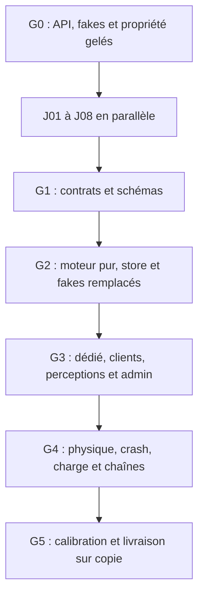

# WORLD_DIRECTOR_IMPLEMENTATION_PLAN

Plan futur 1.0.0. **Aucun job de développement n'est lancé par ce dossier.** Le découpage autorise huit workstreams simultanés après gel d'un socle ; six peuvent être utilisés en regroupant les lots de fin, sans modifier les interfaces.

## 1. G0 — gel du socle avant parallélisation

Le propriétaire intégration inspecte le dépôt réel, ses instructions et ses versions, sans toucher à la génération écologique. Il crée un checkout/branche de développement séparé, verrouille la version NeoForge 21.1 existante compatible et Java 21, et vérifie les signatures des adaptateurs prévues. Il ne migre pas silencieusement la version Minecraft ou les sauvegardes actives.

Produire avant partage : tous les IDs/DTO/enums de `api.model`, les ports de `api.port`, erreurs canoniques, codecs de contrat, interfaces primitives et capabilities, types de réservations/CommitPermit, Clock/RNG abstraits, fakes, structure Gradle/tests, règles d'import et point de composition. Ce socle contient des interfaces et des fakes clairement marqués ; aucun faux effet ne peut être activé en production.

Gel G0 = API compilable, fixtures de contrats stables, manifeste de propriété des fichiers et versions de build. Le code commun est ensuite en lecture seule pour les huit lots. Une modification transversale passe par le propriétaire intégration, nouvelle version d'API et mise à jour atomique des consommateurs ; personne ne patch le package d'un autre lot en parallèle.

## 2. Huit jobs indépendants sur interfaces gelées

### J01 — observation, régions et mémoire

| Champ | Contrat |
| --- | --- |
| ID | J01 |
| Scope | capteurs agrégés, régions dynamiques, CAMP_ROUTINE, decay, personnalité, équité opérationnelle |
| Dependencies | G0 ; fakes Observation/Store/Clock ; intégration J04/J05 ensuite |
| File ownership | `memory/**`, `adapter/neoforge/server/observation/**`, tests de ces packages |
| Interfaces consumed | ObservationPort, DurableStore, DirectorClock, Scope/Region/Player DTO |
| Interfaces produced | MemoryPort, Snapshot providers, pattern/memory deltas |
| Acceptance criteria | mémoire sans trajectoires ; fusion/scission sans duplication ; faits/uniques préservés ; index sparse |
| Tests | T-OBS, T-MEM, T-REG, T-FAIR sur fakes puis observation dédiée |
| Integration gate | G2 pour logique, G3 pour hooks réels |

### J02 — catalogue et contrats de contenu

| Champ | Contrat |
| --- | --- |
| ID | J02 |
| Scope | loader, codecs JSON, validation sémantique, snapshot de catalogue, compilation chaînes/recettes |
| Dependencies | G0 ; descriptions de primitives gelées ; pas besoin du runner réel pour commencer |
| File ownership | `catalog/**`, `data/*/director/**`, `schemas/**`, fixtures de contenu et tests catalogue |
| Interfaces consumed | PrimitiveDescriptor, EventDefinition/ChainDefinition, config registry |
| Interfaces produced | CatalogPort, CatalogSnapshot, validation diagnostics, références compilées |
| Acceptance criteria | schémas fermés ; reload atomique ; neuf fixtures compilables avec capabilities test ; invalides rejetées |
| Tests | T-CAT, golden codecs, références/roles/DAG/budgets/danger |
| Integration gate | G1 contrats, G2 catalogue, G4 recettes physiques réellement qualifiées |

### J03 — décision, rythme et scheduler d'admission

| Champ | Contrat |
| --- | --- |
| ID | J03 |
| Scope | candidats, éligibilité, features/scoring, pools pondérés, pacing, REQUIRE/PREFER service équitable |
| Dependencies | G0 ; fakes catalogue/mémoire/IA/admission ; consomme J01/J02/J08 aux gates |
| File ownership | `engine/**` et tests engine |
| Interfaces consumed | MemoryView, CatalogPort, Quest requests, AiAdvisorPort, Clock/RNG, BudgetView |
| Interfaces produced | DecisionPort, DecisionProposal/AuditDecision ; jamais effet direct |
| Acceptance criteria | pas de singleton actif ; autonomie sans quête/IA ; scoring/replay exacts ; aucun hard filter contourné |
| Tests | T-SEL, T-PACE, T-QST, T-AI, T-CONC sur propositions |
| Integration gate | G2 calcul, G3 runtime, G4 charges/obligations longues |

### J04 — stockage, outbox/inbox et recovery

| Champ | Contrat |
| --- | --- |
| ID | J04 |
| Scope | WAL/checkpoints/blobs, migrations de format, projections, bus durable, orchestrateur de reprise |
| Dependencies | G0 ; fake WorldEffectPort pour tester sans Minecraft ; raccord J05/J08 ensuite |
| File ownership | `persistence/**`, `adapter/neoforge/server/storage/**`, tests disque/crash de store |
| Interfaces consumed | DurableBatch, Mutation/Ownership proof DTO, WorldEffectPort.reconcile, codecs versionnés |
| Interfaces produced | DurableStore, FactBusPort, RecoveryCoordinator, CommitAck |
| Acceptance criteria | ACK seulement après force ; replay sans reset ; corruption isolée ; transaction résultat+facts ; aucune IO tick |
| Tests | T-CRASH, T-MIG, T-QST inbox/outbox, T-BACKUP sur temporaires |
| Integration gate | G2 store, G4 crash monde et entités |

### J05 — runtime, ownership et effets physiques serveur

| Champ | Contrat |
| --- | --- |
| ID | J05 |
| Scope | instances, claims/budgets, chaînes/catastrophes, primitives physiques/faune/météo/objets, cessions |
| Dependencies | G0 ; fakes store/mémoire/catalogue pour commencer ; J04 obligatoire avant tout essai physique réel |
| File ownership | `runtime/**`, `adapter/neoforge/server/effects/**`, `adapter/neoforge/server/ownership/**`, GameTests de primitives |
| Interfaces consumed | CatalogPort, DurableStore, ObservationPort, WorldEffectPort, clock/budgets, notification de perception |
| Interfaces produced | AdmissionPort, Event/Chain/DisasterRunner, WorldEffectPort impl, OwnershipService |
| Acceptance criteria | plusieurs actifs, WAL avant effet, rollback CAS, aucun cleanup d'adopté, danger WARN, propagation bornée |
| Tests | T-CONC, T-MUT, T-OBJ, T-ENT, T-SPAWN, T-WEA, T-DIS, T-CHAIN |
| Integration gate | G2 state machines ; G3 effets simples ; G4 physique/recovery |

### J06 — réseau et perceptions client

| Champ | Contrat |
| --- | --- |
| ID | J06 |
| Scope | payloads, négociation/epochs, codecs, audio/particules/apparitions/ghosts, TTL et nettoyage |
| Dependencies | G0 ; fake event gateway ; synchro de payload DTO avec J07 via API gelée |
| File ownership | `adapter/neoforge/network/**`, `client/perception/**`, tests codecs et clients |
| Interfaces consumed | PerceptionIntent/Stop/Reset, SessionIdentity, capability registry, Admin DTO encodés seulement |
| Interfaces produced | Perception transport/ack, client managers, bounded codec registry |
| Acceptance criteria | perceptions ciblées, aucune collision divergente, classe client non chargée sur dédié, Stop/TTL/epochs sûrs |
| Tests | T-NET, matrice M asymétrique et cleanup, T-LOG carnet opt-in |
| Integration gate | G2 codecs, G3 dédié+clients, G4 rendu/performance et dangers |

### J07 — dashboard et administration v1

| Champ | Contrat |
| --- | --- |
| ID | J07 |
| Scope | façade queries/commands, permissions, cinq onglets, commandes de secours, replay/simulation/audit |
| Dependencies | G0 ; fakes AdminReadModel/admission ; J06 pour transport réel |
| File ownership | `admin/server/**`, `admin/client/**`, `adapter/neoforge/server/commands/**`, tests admin |
| Interfaces consumed | AdminPort DTO, read models monde/région/joueur/actifs/audit, AdmissionPort |
| Interfaces produced | AdminPort impl, commandes, Screen client et read projections |
| Acceptance criteria | toutes fonctions minimales, refus clairs, simulation sans effet, force soumis à mêmes validations |
| Tests | T-ADM, T-NET autorité/tailles, T-LOG export et absence de secrets |
| Integration gate | G2 façade, G3 UI/commandes réelles, G4 inspection de catastrophe/reprise |

### J08 — intégrations facultatives et couche IA

| Champ | Contrat |
| --- | --- |
| ID | J08 |
| Scope | Quest Core adapter, import de lieux WorldPrep, AiAdvisor disabled/transport/fallback |
| Dependencies | G0 ; fakes store/catalogue/facts ; J04 pour inbox/outbox réel |
| File ownership | `integration/quest/**`, `integration/locations/**`, `integration/ai/**`, tests d'intégration correspondants |
| Interfaces consumed | DirectorRequest/Fact envelope, DurableStore/FactBus, location import schema, AiInput/Proposal |
| Interfaces produced | QuestDirectorPort, LocationImportPort, AiAdvisorPort, DisabledAiAdvisor |
| Acceptance criteria | fonctionnement sans les trois intégrations ; import atomique ; requêtes idempotentes ; IA jamais autoritaire |
| Tests | T-QST, T-AI, import positif/négatif, absence de jar WorldPrep/Quest Core |
| Integration gate | G2 contrats/fallback/import, G3 intégration facultative, G4 crash outbox/retards |

## 3. Ordre des gates et capacité parallèle

G1 ne prétend pas attendre la fin des huit lots ; c'est leur premier point commun de conformité. G2 exige catalogue/mémoire/store/engine interopérables. G3 ne peut remplacer le réseau réel par des fakes. G4 exige les implémentations physiques promises et leurs preuves ; une recette non qualifiée ne doit pas apparaître « prête » parce que son JSON est valide. G5 donne le feu de livraison seulement pour les capacités effectivement qualifiées et le périmètre produit demandé.

Maximum utile : huit propriétaires de lots + intégration tenue par un des propriétaires en dehors des fenêtres de modification partagées. Au-delà, les changements de contrats et le bootstrap deviennent le goulet. En capacité six : regrouper J07/J06, J08/J03 ; garder la propriété des répertoires documentée. Les lots parallèles ne lisent/écrivent jamais la carte écologique en cours pour leurs tests.

## 4. Intégration, changement de contrat et livraison

Le propriétaire intégration conserve `api/**`, `bootstrap/**`, build/CI et registre central de configuration. Chaque lot fournit commit, tests, types produits/consommés, nouvelles capabilities et rapport d'acceptation. Les changements passent par compilation/test de contrat avant merge ; pas de stub silencieux branché en production. Des manifests de versions empêchent de mélanger schema v1 et runner incompatible.

Les fakes portent un mode `TEST_ONLY` vérifié au bootstrap. Le JAR de livraison échoue explicitement si une capability annoncée est fournie par un fake. Le package final comprend JAR serveur/client, données de contenu, configuration approuvée, procédure de backup/recovery et rapports de tests ; aucune « livraison » ne signifie déplacer le store de la carte active sans vérification.

Les décisions de gameplay ouvertes sont des calibrations identifiées : fréquences relatives, durées, ampleur/effets de danger, budgets de faune et persistance des traces. Le développement peut implémenter les mécanismes et tester avec le profil fourni ; leur mise en service live attend validation produit. Il n'existe pas de choix technique structurant laissé à une invention locale de job.
